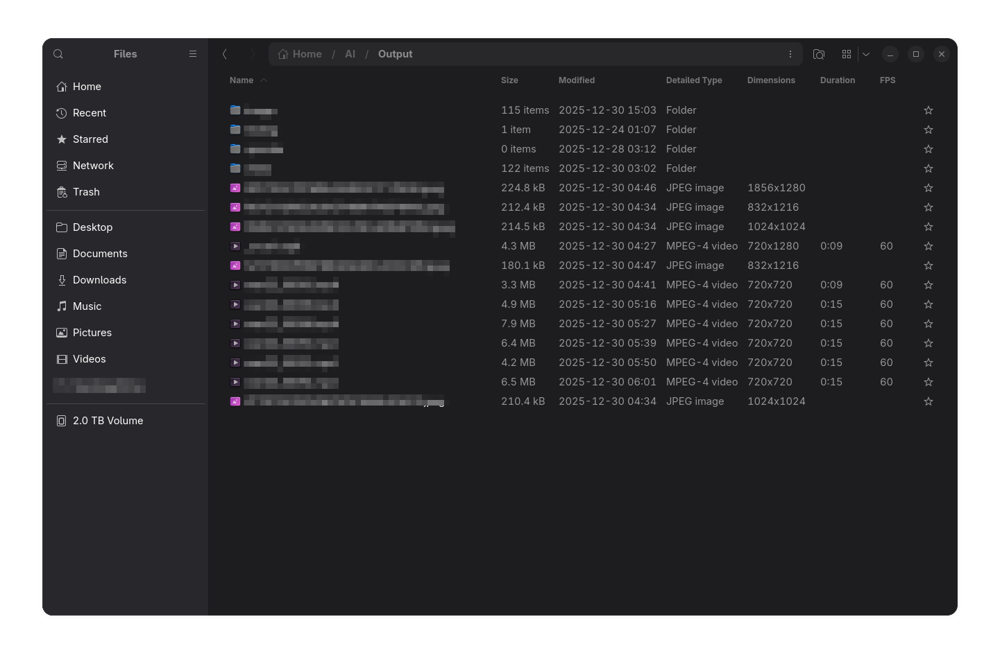

# Nautilus Media Columns

Adds **Dimensions**, **Duration**, and **FPS** (Framerate) columns to Nautilus (GNOME Files) list view for images and videos. Metadata is read using GNOME-native libraries and cached for performance.

<p align="center">
  
</p>

***

## Features

- **Dimensions**
  - Images: fast header-only probe (no full decode)
  - Videos: via GStreamer discoverer
- **Duration** (videos)
- **FPS (Framerate)** (videos, rounded to whole numbers)
- **Non-blocking**
  - Uncached files are probed during main-loop idle time; columns fill in progressively instead of freezing the window
- **Persistent cache**
  - SQLite (WAL mode)
  - Indexed by path; invalidated when mtime or size changes
  - Automatic pruning:
    - Time-based TTL: 90 days since last access
    - Size-based cap: 50,000 rows (least-recently-used)
- **No ffmpeg dependency**
  - Videos use GNOME-provided GStreamer
- **Image metadata**
  - Prefers GExiv2 (orientation-aware)
  - Falls back to GdkPixbuf per file if GExiv2 is unavailable or returns no dimensions
- **Graceful degradation**
  - Without GstPbutils, image columns still work; video columns are disabled

---

## Requirements

- Python 3
- Nautilus with **nautilus-python (API 4.0)**
- GStreamer (installed by default on GNOME desktops)
- ***Recommended***:
  - **GstPbutils GI typelib**: required for video columns
  - **GExiv2 GI bindings**: orientation-aware image dimensions; otherwise GdkPixbuf is used
- ***Optional***:
  - **python3-systemd**: sends logs to the journal under the `nautilus-media-columns` identifier (needed for the `journalctl -t` commands below)

Debian / Ubuntu:

```bash
sudo apt update
sudo apt install python3-nautilus gir1.2-gst-plugins-base-1.0 gir1.2-gexiv2-0.10 python3-systemd
```

Other distros: package names vary (look for the nautilus-python, GstPbutils typelib, and GExiv2 typelib packages).

Tested on:
- GNOME / Nautilus 48 & 49
- Ubuntu 25.04 & 25.10
- Debian 13 (trixie)

Expected to work on:
- Targets nautilus-python API 4.0 (GNOME 45+); expected to work across distros, but dependency packaging may vary.

---

## Installation (per user)

```bash
mkdir -p ~/.local/share/nautilus-python/extensions
wget https://raw.githubusercontent.com/derek-shnosh/nautilus-media-columns/main/nautilus-media-columns.py \
  -O ~/.local/share/nautilus-python/extensions/nautilus-media-columns.py
nautilus -q
```

Restart Nautilus, switch to **List View**, open **Visible Columns**, and enable:
- Dimensions
- Duration
- FPS

### Development install

To run from a local clone, symlink the script instead of downloading it:

```bash
mkdir -p ~/.local/share/nautilus-python/extensions
ln -sf "$PWD/nautilus-media-columns.py" \
  ~/.local/share/nautilus-python/extensions/nautilus-media-columns.py
nautilus -q
```

Nautilus loads extensions at startup, so run `nautilus -q` after each edit.

---

## Cache

Cache database location:

```
~/.cache/nautilus-media-columns/media.sqlite3
```

Safe to delete at any time; it will be recreated automatically.

Cache behavior:
- Entries are refreshed only if **mtime or size changes**
- Cache is pruned automatically based on TTL and max-row limits
- Writes are batched and committed within a couple of seconds

---

## Supported Formats

**Images**
- PNG, JPG/JPEG, WebP, BMP, TIF/TIFF

**Videos**
- MP4, MKV, MOV, AVI, WebM, M4V

(Actual codec support depends on installed GStreamer plugins.)

---

## Performance Notes

- First visit to a folder probes uncached files in the background; columns fill in over a few seconds
- Subsequent visits are instant (served from cache)
- The window stays responsive while probing

---

## Troubleshooting

- **Columns not showing up?**
  - Restart Nautilus: `nautilus -q`
  - Ensure you are in **List View** and the columns are enabled via **Visible Columns**.

- **Image columns work, but Duration/FPS are always empty?**
  - The log shows `GstPbutils unavailable; video columns disabled`.
  - Install the GStreamer GI typelib for `GstPbutils` (Debian/Ubuntu: `gir1.2-gst-plugins-base-1.0`), then restart Nautilus.

- **No duration or FPS for some videos?**
  - Codec support depends on installed GStreamer plugins.
  - You may need additional packages (e.g. `gstreamer1.0-libav`, `gstreamer1.0-plugins-ugly`).

- **Images show no dimensions?**
  - The log shows `No image backend available`.
  - Install the GExiv2 GI bindings (Debian/Ubuntu: `gir1.2-gexiv2-0.10`); GdkPixbuf is used as a fallback when available.

---

## Debug Logging

The `journalctl -t` commands require `python3-systemd`. Without it, messages still go to Nautilus's stderr.

### View normal logs

```bash
journalctl --user -f -t nautilus-media-columns
```

Shows:
- INFO
- WARNING
- ERROR

### Enable debug logging

```bash
G_MESSAGES_DEBUG=nautilus-media-columns nautilus
journalctl --user -f -t nautilus-media-columns -p debug
```

### View debug output directly in terminal

```bash
G_MESSAGES_DEBUG=nautilus-media-columns nautilus 2>&1 | grep -i nautilus-media-columns
```

### Notes

- Debug logging is disabled by default.
- Debug logs include cache activity, media probing details, database lifecycle events, and GStreamer diagnostics.

---

## License

MIT
